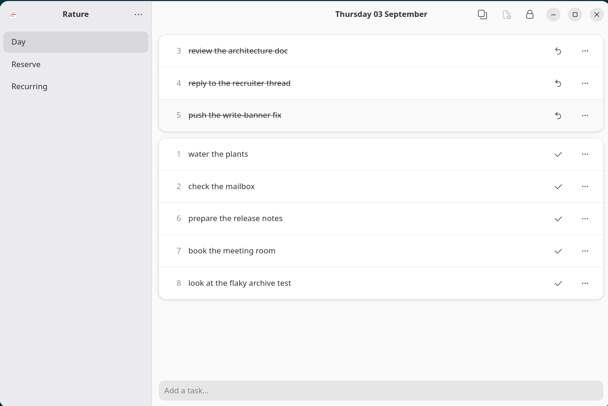
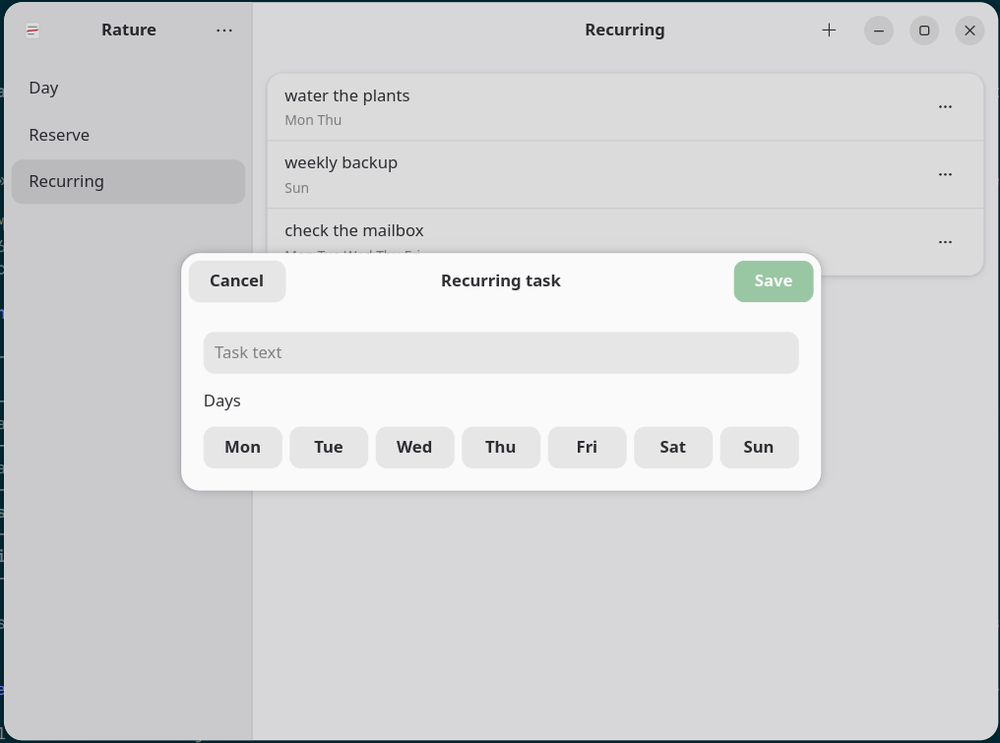
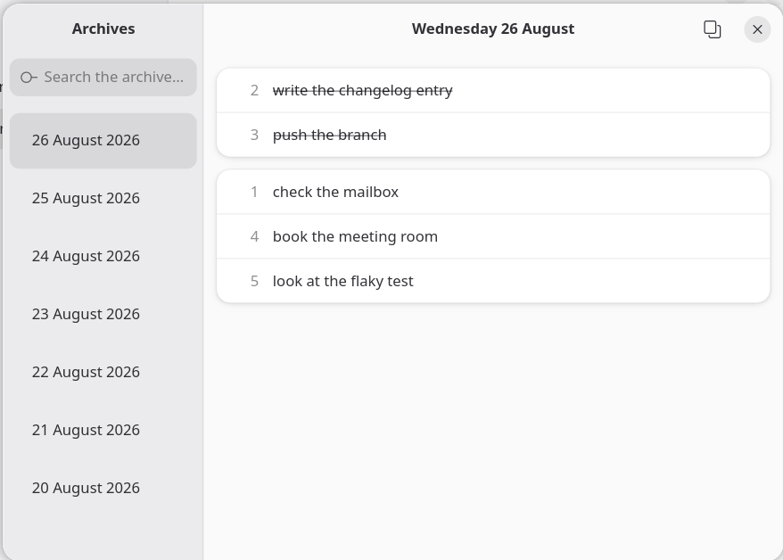
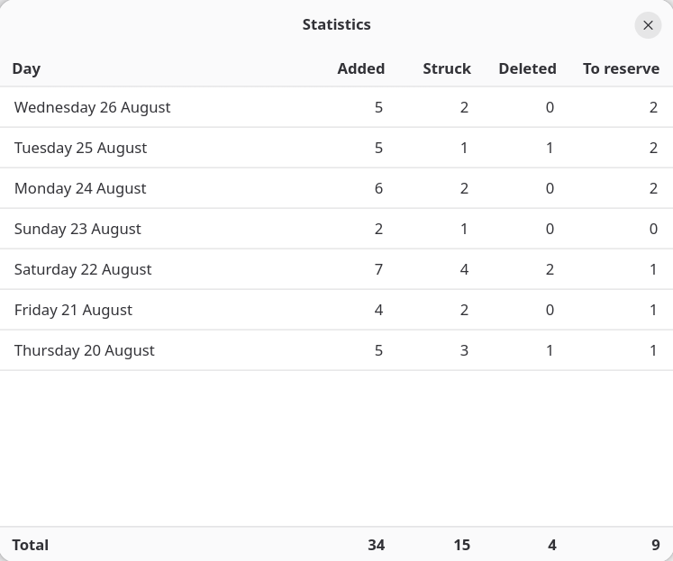

<div align="center">

# Rature


**A support, not a coach.**

[](https://github.com/VertOurs/Rature/actions/workflows/ci.yml)
[](https://github.com/VertOurs/Rature/releases)
[](LICENSE)

</div>

## Why another todo app

Dozens of task managers already exist; I tried a fair number of them
before writing this one. Most assume a working memory and a motivation
system that ADHD and depression do not reliably provide: a plan to hold
in mind, priorities to keep straight, a backlog to catch up on, a streak
to protect. Those are exactly the mechanisms that make a list stop
working when executive function or motivation is the part that is
missing, turning a task manager into one more source of guilt. Rature
removes them instead of managing around them: nothing to plan, nothing
to prioritize, nothing to fall behind on, nothing scored.

A struck task stays visible in its block instead of disappearing: a
small, precious hit of "I did that" in a context where it does not come
easily otherwise. Unfinished work does not carry over as a growing
backlog on the next day's list either; it returns to the reserve
instead, and it is up to me, the next day, to decide what goes on the
list according to whatever energy I actually have.

## What it is

Rature keeps one numbered list for the day. You add tasks one by one, in no
particular order, and strike them through as the day goes. Struck tasks stay
visible in a block at the top, as a trace of what got done. There is no
planning, no categories, no scoring, no encouragement. Rature is a support,
not a coach.

The method it reproduces:

- Tasks are dictated one at a time, in bulk, with no imposed order.
- Each task joins a numbered list, without comment.
- Striking a task bars it and moves it to a "Struck" block at the top.
- Deleting a task removes it without a visible trace. It is distinct from
  striking: an abandonment, not an achievement. The two actions are never
  merged.
- The list can be frozen to end the composition of the day while striking,
  renaming and reordering stay possible.

## Screenshots






## Features

- **Day view** — add, strike, unstrike, rename in place, delete, reorder by
  drag-and-drop, freeze the list. `Shift+Enter` logs a task already struck.
- **Tomorrow** — prepare the next day's list the evening before. Day tasks
  and reserve items move there from their row menu or by drag-and-drop;
  the list enters the day when the next day starts, after the recurring
  tasks. Prepared tasks get their numbers only then.
- **Reserve** — an undated list you draw from in the morning, reordered by
  drag-and-drop; unfinished day tasks return to it at the day rollover, or
  right away with the arrow at the start of a Day view row.
- **Recurring** — task templates tied to weekdays, every week or every two
  weeks, injected automatically each new day.
- **Priority** — a single marker on a task or a reserve item. It never
  changes the order or the numbers.
- **Archives window** — every past day, read-only, with a search over task
  text.
- **Statistics window** — a plain table of counts per archived day, no
  chart and no judgement.
- **Undo the last deletion**, **copy a day as plain text**, keyboard
  shortcuts with a help window, a full French translation, and
  Spanish, German, Brazilian Portuguese, Russian and Esperanto machine
  translations.

## Installing

From the self-hosted Flatpak repository, with automatic updates:

```
flatpak remote-add --if-not-exists rature \
  https://vertours.github.io/Rature/io.github.vertours.Rature.flatpakrepo
flatpak install rature io.github.vertours.Rature
```

A standalone `.flatpak` bundle is attached to each
[release](https://github.com/VertOurs/Rature/releases) for a one-off
install without adding the repository.

AUR, COPR and Mageia packages are prepared (`build-aux/`) but not yet
submitted. Flathub is deliberately not a target
([`docs/adr/0001-reject-flathub.md`](docs/adr/0001-reject-flathub.md)).

## Status

Version 2 is complete, in daily use, and updates itself from the repository
above. Version 3 is under way; [CHANGELOG.md](CHANGELOG.md) lists every release.

## Engineering

- **Business logic apart from the interface.** `core/` never imports GTK,
  and a test fails if it does
  ([ADR 0002](docs/adr/0002-core-ui-separation.md)). It is type-checked
  with `mypy --strict` and covered at 100%, branches included.
- **Interface tested on real widgets.** The UI tests drive the installed
  application under `gtk4-broadwayd`, inside the GNOME SDK it ships on,
  with any GTK critical failing the run.
- **Data that survives a crash.** One JSON file, written atomically: temp
  file, `fsync`, rename, then `fsync` of the folder
  ([ADR 0003](docs/adr/0003-single-json-file.md)).
- **A versioned format.** Each migration is tested on crafted files, the
  data file is backed up before one runs, and a file written by a newer
  version is refused rather than overwritten.
- **Signed releases.** The Flatpak repository and every release tag are
  GPG-signed, and every commit on `main` since the first pull request
  carries a verified signature.
- **A pinned CI.** Actions by commit hash and development tools by exact
  version, both bumped by Dependabot; the container image by digest,
  bumped by hand.

Built with AI assistance (Claude Code); I write the specification,
review every change, and merge it.

Design decisions are recorded in [`docs/adr/`](docs/adr/); the roadmap
lives under `docs/internal/` (in French). The architecture is
[`docs/ARCHITECTURE.md`](docs/ARCHITECTURE.md).

## Building from source

Requires Meson, GTK 4, libadwaita, GLib and the gettext tools, and Python
3.13 or newer.

```
meson setup build
meson compile -C build
meson install -C build
```

Run the checks:

```
meson test -C build
pip install --group dev   # pip 25.1 or newer
pytest --cov
```

The full list, lint and UI tests included, is in
[CONTRIBUTING.md](CONTRIBUTING.md).

### Flatpak

```
flatpak-builder --user --install --force-clean build-flatpak \
  build-aux/flatpak/io.github.vertours.Rature.yml
flatpak run io.github.vertours.Rature
```

## Contributing

See [CONTRIBUTING.md](CONTRIBUTING.md).

## Sponsoring

If Rature is useful to you, sponsoring is welcome through the "Sponsor"
button at the top of this repository, or directly on
[GitHub Sponsors](https://github.com/sponsors/VertOurs). Entirely
optional: the app, its updates and its packages stay free regardless.

## License

GPL-3.0-or-later. See [LICENSE](LICENSE).
